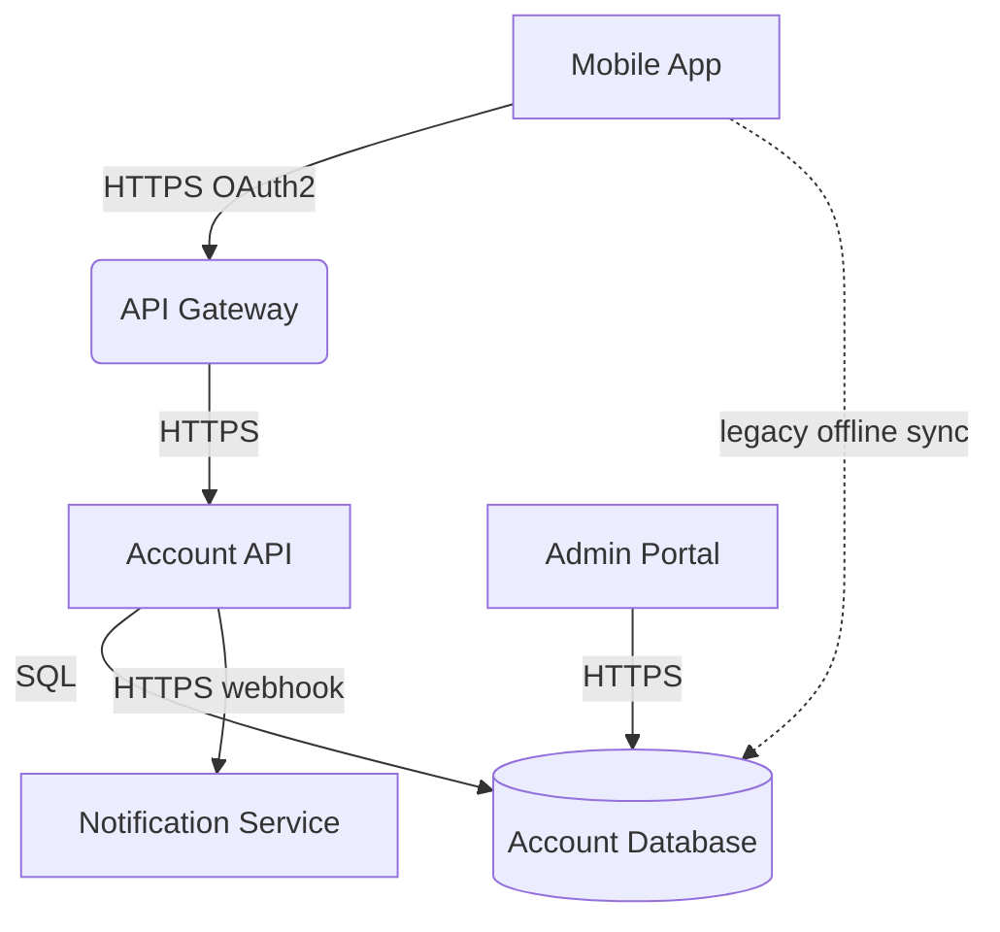

# Mobile Banking Platform Architecture

## Overview

The Mobile Banking Platform lets retail customers check balances and move
money from the mobile app. The API Gateway is the single internet-facing
entry point and fronts the Account API. A legacy background sync path still
lets the mobile app write directly to the Account Database for offline
support.

## Data Flow

## Components

| Component | Technology | Notes |
|---|---|---|
| Mobile App | iOS / Android native | Public app store distribution |
| API Gateway | Kong | Terminates TLS, internet-facing |
| Account API | Java / Spring Boot | Internal service, not directly internet-facing |
| Account Database | PostgreSQL | Stores balances and account PII |
| Notification Service | Third-party SMS/email vendor | Receives transaction alerts |
| Admin Portal | Internal React app | Used by support staff to look up accounts |

## Third-Party Integrations

The Notification Service is a third-party vendor used to send transaction
alerts by SMS and email. The Account API calls its webhook with the
customer's name, phone number, and last transaction amount.

## Known Gaps

- TODO: confirm whether the Account API enforces object-level authorization
  on every account lookup, or relies solely on the API Gateway's OAuth2 token.
- Assumption: the API Gateway terminates TLS and forwards over HTTPS internally.
- Assumption: Admin Portal network exposure is not yet documented; it may be
  reachable from the general corporate network rather than a restricted
  admin VLAN.
- TBD: the legacy mobile-to-database offline sync path predates the API
  Gateway and has not been reviewed for authentication or authorization.
